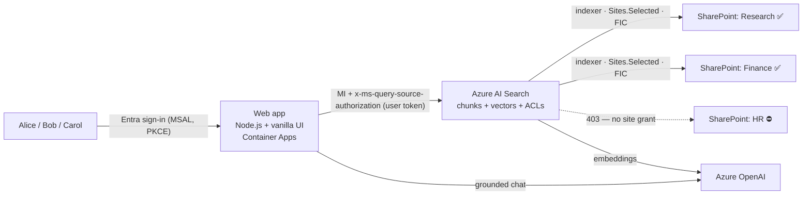

# Permission-aware search over SharePoint with Azure AI Search

An end-to-end, `azd up`-deployable demo that **proves** SharePoint permissions follow your content into Azure AI Search:

* **Same query, different people, different results.** Alice, Bob and Carol search the same index; each sees only
  the chunks SharePoint lets them read. The trimming happens *inside* Azure AI Search, before ranking, using the
  user's own Entra token (`x-ms-query-source-authorization`).
* **ACL-trimmed RAG.** The *Ask* tab grounds Azure OpenAI answers only on chunks the signed-in user can read.
* **Least privilege with `Sites.Selected`.** The ingestion app is admin-consented for `Sites.Selected`, yet can read only
  the two sites it was explicitly granted. A third site (*HR Confidential*) is never granted — its indexer fails and a
  live Graph probe returns **403**. Admin consent ≠ access.
* **No secrets.** The indexer authenticates with a **federated identity credential** that trusts the search service's
  managed identity. Azure AI Search and Azure OpenAI have key auth disabled.
* **Fully automated.** Entra apps, consent, federated credentials and groups (Microsoft Graph Bicep), Azure resources,
  three SharePoint sites with folders and unique permissions, demo users, CC BY arXiv papers, the search pipeline and the
  web app — one `azd up`.

> The SharePoint in Microsoft 365 indexer and ACL ingestion are **preview** features (REST API `2026-08-01-preview`).
> Not for production. For production RAG over SharePoint, also consider the remote SharePoint knowledge source
> (Copilot Retrieval API) or Copilot Studio, as recommended in the documentation.

## What gets deployed



| Site / folder | SharePoint permission | Alice | Bob | Carol | Codeword |
|---|---|:-:|:-:|:-:|---|
| Research / Public | *All staff* Entra group (site) | ✔ | ✔ | ✔ | BLUEBIRD |
| Research / Quantum | *Quantum team* Entra group (unique) | ✔ | – | – | AURORA |
| Research / Bio | Carol, direct share (unique) | – | – | ✔ | KESTREL |
| Finance / Reports | SharePoint **Members** site group (Bob) | – | ✔ | – | NIGHTJAR |
| HR / Confidential | *All staff* — but **no Sites.Selected grant** | – | – | – | OSPREY |

Details: [docs/architecture.md](docs/architecture.md).

## Quick start

Prerequisites (details in [docs/prerequisites.md](docs/prerequisites.md)): a Microsoft 365 tenant with SharePoint and a
Global Administrator, an Azure subscription (Owner) in the **same tenant**, 3 spare licences that include SharePoint,
`azd` and Node.js 20+.

```powershell
git clone <this repo>
cd aisearch-sharepoint-acl

# Sign azd in as the tenant admin (an isolated config avoids picking a guest account from the Azure CLI)
$env:AZD_CONFIG_DIR = "$HOME\.azd-acl-demo"
azd config set auth.useAzCliAuth false
azd auth login --tenant-id <tenant-id>

azd env new acl-demo --location francecentral
azd env set AZURE_TENANT_ID <tenant-id>
azd up
```

During `azd up`:

1. **preprovision** checks the region (Sweden Central / West Europe / North Europe / Germany West Central are blocked —
   *"high demand, prevents the creation of new search services"*) and discovers your SharePoint host name.
2. **provision** deploys Azure resources and Entra objects (≈ 15 min, the search service takes ≈ 10).
3. **postprovision** opens a browser **once** for the admin sign-in to the deployment-only *setup* app, then:
   creates the personas (+ Temporary Access Passes), three communication sites, folders, unique permissions, uploads the
   papers, grants `Sites.Selected` on Research and Finance only, creates the search pipeline and waits for the first runs.
4. **deploy** builds the web app in Azure Container Registry and rolls it out.

Open the URL printed at the end (`azd env get-value WEB_URL`). Persona sign-in details are in
`.azure/<env>/demo-credentials.txt` (gitignored). Then follow the [demo script](docs/demo-script.md) or the full
[test plan](docs/test-plan.md) (every prompt with the expected result per persona, and who can read which document).

**Testing tips**

* Use one **InPrivate** window (or browser profile) per persona, otherwise single sign-on reuses your admin session.
  Alternatively open `<WEB_URL>/?login_hint=alice.acldemo@<your domain>` — the app then forces a fresh sign-in for that user.
* Sign in with *Other ways to sign in → Temporary Access Pass*. Answer **Yes** on "Stay signed in?".
* The app uses the full-page redirect flow (no popups).

### Re-running pieces

```powershell
node scripts/setup/index.mjs --only users        # re-issue Temporary Access Passes
node scripts/setup/index.mjs --only sharepoint   # sites, content, permissions, grants (idempotent)
node scripts/setup/index.mjs --only search       # index, skillset, data sources, indexers
```

### Local development

```powershell
cd app; npm install
# take the values from `azd env get-values`
$env:AZURE_TENANT_ID="..."; $env:WEB_APP_CLIENT_ID="..."; $env:SEARCH_ENDPOINT="..."; $env:AZURE_OPENAI_ENDPOINT="..."
$env:GROUP_ALL_STAFF_ID="..."; $env:GROUP_QUANTUM_ID="..."; $env:GROUP_ADMINS_ID="..."
$env:SITE_RESEARCH_URL="..."; $env:SITE_FINANCE_URL="..."; $env:SITE_HR_URL="..."
npm run dev   # http://localhost:3000 — uses your azd login instead of the managed identity
```

The live Sites.Selected probe only works in Azure (it uses the managed identity as a federated credential).

## The web app

| Tab | What it shows |
|---|---|
| **Search** | Keyword / semantic / hybrid search as the signed-in user; codeword chips; "No results for you" when everything matching is protected; **raw request / response** JSON (tokens redacted) |
| **Ask** | RAG chat; every question runs a new trimmed search with the user's token; citations link back to SharePoint; sample questions always visible; **New conversation** |
| **Sites.Selected proof** | App-only Graph probe per site (200 vs 403), the token's `roles` claim, indexer status and errors |
| **How it works** | Flow, the four mechanisms and a **live** who-can-see-what matrix: admins get every persona computed from the stored ACLs + live group resolution; everyone gets their own row confirmed by real trimmed queries |
| **Admin** *(admins group)* | Elevated read: every chunk with its `UserIds`/`GroupIds` resolved to names · indexer status, **Run now**, **Resync ACLs** · live group-membership toggle |

Stack: Node.js (Express 5), vanilla HTML/CSS/ES modules (no build step), MSAL Browser v5 (SPA + PKCE, redirect bridge),
`@azure/identity`, `jose`.

## How indexing works and how often

* One indexer per site on a schedule (`INDEXER_SCHEDULE`, default `PT15M`, minimum `PT5M`).
* Incremental: new/changed/deleted files and **item-level** permission changes are picked up on each run.
* **Parent-scope** permission changes (site, library, folder) need `/resync` with `permissions` (Admin tab button).
* **Entra and SharePoint group membership** is resolved at **query time** — no re-indexing.

See [docs/indexing-and-frequency.md](docs/indexing-and-frequency.md).

## Repository layout

```text
azure.yaml                    azd project (hooks: preprovision, postprovision; service: web)
infra/
  main.bicep                  subscription scope: RG + modules + outputs
  modules/core.bicep          AI Search, Azure OpenAI, Container Apps env, ACR, identities, RBAC
  modules/entra.bicep         Microsoft Graph Bicep: apps, consent, federated credentials, groups
  modules/web.bicep           Container App
scripts/
  preprovision.mjs            region guard + SharePoint host discovery
  setup/index.mjs             postprovision orchestrator (idempotent)
  setup/steps/users.mjs       personas, licences, groups, Temporary Access Pass
  setup/steps/sharepoint.mjs  sites, papers, folder ACLs, site user lists, Sites.Selected grants
  setup/steps/search.mjs      index / skillset / data sources / indexers
  setup/cleanup.mjs           remove what azd down doesn't (sites, users, apps, groups)
  setup/content.json          sites, folders, codewords, arXiv paper IDs
  search/*.json               search object templates
app/                          web app (server.mjs, src/, public/)
data/papers/                  CC BY 4.0 sample PDFs + ATTRIBUTION.md
demo/queries.http             raw REST queries (no token / persona / elevated read)
docs/                         architecture, prerequisites, frequency, proof, limitations, demo script, test plan
```

## Clean up

```powershell
node scripts/setup/cleanup.mjs   # SharePoint sites, demo users, Entra apps and groups
azd down --purge                 # Azure resources
```

If the setup script enabled the Temporary Access Pass method (it only does so when TAP was disabled), it is scoped to the
demo personas group; disable it in the Entra admin center if you no longer need it.

## Limitations

Preview features, Conditional Access caveats, unsupported sharing links/guests, nested-group behaviour, the
"user must be in each indexed site's user list" requirement, stale ACLs between runs, and the `Files.Read.All` question —
see [docs/limitations.md](docs/limitations.md), which also records the validation results from a real tenant.

### Site collection or a specific site?

`Sites.Selected` is granted **per site collection**: the grant is the security boundary. What is indexed can be narrower —
one subsite, one library or one folder — through the data source container query (`includeLibrariesInSite`,
`includeLibrary`, `includeFolder`, `includeSubsites`…). Permissions are always ingested **per item**, so trimming works the
same at any scope. Details: [limitations.md](docs/limitations.md#scope-site-collection-site-library-or-folder).

## Prior art

* [notanaha/SampleSharePointIndex](https://github.com/notanaha/SampleSharePointIndex) — REST files for a SharePoint index
  with ACL filtering and agentic retrieval (client secret, single site).
* [Azure/Copilot-Studio-and-Azure — lab 2.3](https://github.com/Azure/Copilot-Studio-and-Azure/tree/main/labs/2.3-ai-search-sharepoint-indexer)
  — SharePoint indexer with Copilot Studio (no ACLs).
* [Azure-Samples/azure-search-rest-samples — acl](https://github.com/Azure-Samples/azure-search-rest-samples/tree/main/acl)
  — query-time ACL samples.

This repository adds: azd end-to-end automation (including Entra via Graph Bicep), secretless federated credentials,
`Sites.Selected` with a multi-site negative proof, SharePoint site groups, and an ACL-trimmed RAG UI.

## Microsoft Learn references

* [SharePoint in Microsoft 365 indexer](https://learn.microsoft.com/azure/search/search-how-to-index-sharepoint-online)
* [Use a SharePoint indexer to ingest permission metadata](https://learn.microsoft.com/azure/search/search-indexer-sharepoint-access-control-lists)
* [Query-time ACL and RBAC enforcement](https://learn.microsoft.com/azure/search/search-query-access-control-rbac-enforcement)
* [Azure AI Search region support](https://learn.microsoft.com/azure/search/search-region-support)
* [Microsoft Graph Bicep](https://learn.microsoft.com/graph/templates/bicep/overview-bicep-templates-for-graph)

## Sample content

The PDFs in [`data/papers/`](data/papers/) are unmodified arXiv papers licensed under **CC BY 4.0**; authors, titles and
links are in [`data/papers/ATTRIBUTION.md`](data/papers/ATTRIBUTION.md). The setup script uploads them with a readable
file name and re-checks each licence through arXiv OAI-PMH (if a file is missing it is downloaded again).

## License

[MIT](LICENSE)
