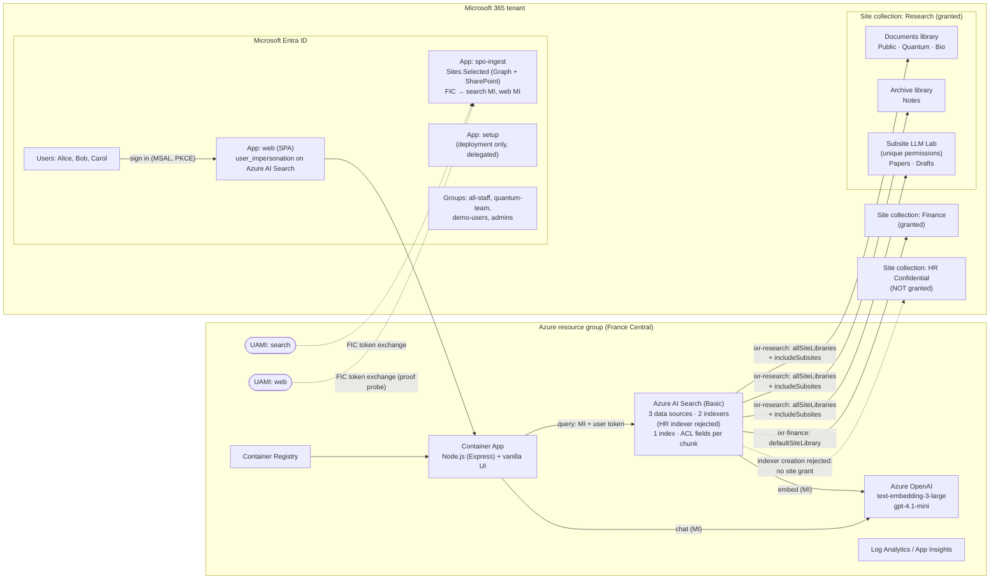
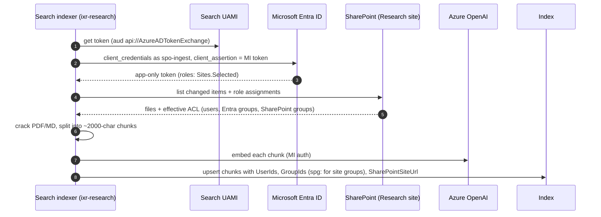
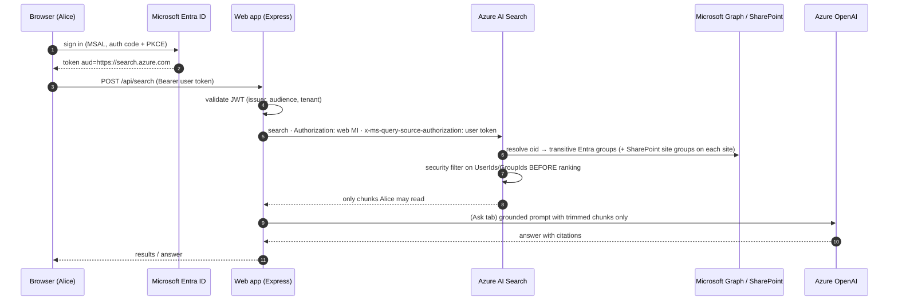

# Architecture

## Components

## Identities and permissions

| Identity | Type | Permissions | Used for |
|---|---|---|---|
| **spo-ingest** app | App registration, **no secret** | Graph `Sites.Selected` · SharePoint `Sites.Selected`, `User.Read.All` (application, admin-consented) + **per-site grant** on Research and Finance only | SharePoint indexer (content + ACLs), query-time SharePoint site group resolution |
| Search UAMI | User-assigned managed identity | Federated credential subject on spo-ingest · `Cognitive Services OpenAI User` | Indexer → SharePoint, embeddings, query vectorizer |
| Web UAMI | User-assigned managed identity | `Search Index Data Reader/Contributor`, `Search Service Contributor`, `Cognitive Services OpenAI User`, `AcrPull`, Graph `GroupMember.Read.All` + `User.ReadBasic.All` (application), FIC subject on spo-ingest | Query authorisation, chat, admin views, Sites.Selected probe |
| **web** app | SPA app registration | Delegated, consented for all users: `openid profile offline_access User.Read`, `Files.Read.All`, `Sites.Read.All` (Access tab: read SharePoint as the user — bounded by the user's own access), Azure AI Search `user_impersonation`. Consented for the deploying admin only: `GroupMember.ReadWrite.All` (live membership change), `Sites.FullControl.All` (Proof tab: read the Sites.Selected grants of each site) | End-user sign-in/out; the user token is what Azure AI Search uses to trim results |
| **setup** app | Public client | Delegated, consented for the deploying admin only: Graph `Sites.FullControl.All`, `Files.ReadWrite.All`, `User.ReadWrite.All`, `Group.ReadWrite.All`, `LicenseAssignment.ReadWrite.All`, `UserAuthenticationMethod.ReadWrite.All`, `Policy.ReadWrite.AuthenticationMethod`, `Organization.Read.All` · SharePoint `AllSites.FullControl` | Deployment-time only: create sites, folders, permissions, users, Sites.Selected grants. Safe to delete afterwards |
| Deploying admin | User | `Search Service Contributor`, `Search Index Data Contributor`, `Cognitive Services OpenAI User` | Creating the search pipeline, local development |

No API keys anywhere: Azure AI Search and Azure OpenAI have local (key) auth **disabled**.

### Why the ingestion app needs both Microsoft Graph and SharePoint permissions

The indexer reads SharePoint through two APIs (see the permission table in
[Use a SharePoint indexer to ingest permission metadata](https://learn.microsoft.com/azure/search/search-indexer-sharepoint-access-control-lists)):

| API | Permission | Why |
|---|---|---|
| Microsoft Graph | `Sites.Selected` | Files and their **Entra** permissions (users, Entra groups) |
| SharePoint | `Sites.Selected` | **SharePoint site group** permissions (Owners/Members/Visitors) — only the SharePoint REST API exposes them. Bob's Finance access depends on it |
| SharePoint | `User.Read.All` | Query-time resolution of a user's SharePoint site groups (`sharePointConnectorAppRegistration` on the index) |

If you only ever grant access to Entra users and Entra groups, Graph `Sites.Selected` alone is enough (and a client
secret would also work). As soon as SharePoint permissions are added, a **federated credential** is required — this demo
always uses one. The documentation also lists Graph `Files.Read.All`; it's tenant-wide and would make `Sites.Selected`
pointless, so it's **not** granted here (a `read` site grant was enough in testing).

### Seeing which app has which site grant

SharePoint's UI (site permissions, advanced permissions, admin center) doesn't show `Sites.Selected` app grants, and the
Entra admin center only shows the tenant-wide consent. To see the per-site grants:

* **This app:** *Sites.Selected proof* tab, signed in as an admin → each site card lists the granted apps and roles.
* **Graph Explorer:** `GET https://graph.microsoft.com/v1.0/sites/<tenant>.sharepoint.com:/sites/acldemo-research:/permissions`
  (HR returns an empty list).
* **PnP PowerShell:** `Get-PnPAzureADAppSitePermission -Site https://<tenant>.sharepoint.com/sites/acldemo-research`.

## Ingestion flow

For the **HR** site step 4 fails with *access denied*: the app's token is valid and admin-consented, but SharePoint has no site permission for it.

## Query flow

Key properties:

* The app never filters results itself — trimming happens inside Azure AI Search.
* Without a user token, ACL-protected documents are **not** returned (behaviour since the 2025-11-01-preview API).
* Entra group membership is resolved at **query time**: adding Carol to *Quantum team* takes effect on the next query, no re-indexing.
* If ACL evaluation fails (for example Graph unavailable) the service returns 5xx — never a partially filtered result.

## Data model (index `sharepoint-acl-index`)

| Field | Purpose |
|---|---|
| `chunk_id` (key), `parent_id` | Chunk and source-document keys (index projections, `skipIndexingParentDocuments`) |
| `title`, `url`, `path`, `site`, `last_modified` | SharePoint metadata (`metadata_spo_*`) |
| `chunk`, `chunk_vector` (3072-d) | Text and embedding; integrated vectorizer for queries |
| `UserIds` (`permissionFilter: userIds`) | Entra object IDs of users granted directly |
| `GroupIds` (`permissionFilter: groupIds`) | Entra group object IDs, and SharePoint site groups as `spg:<id>` |
| `SharePointSiteUrl` (`sharepointSiteUrl: true`) | Lets the service resolve SharePoint site groups per site at query time |

Index-level settings: `permissionFilterOption: enabled` and `sharePointConnectorAppRegistration` (spo-ingest app ID + search UAMI client ID).

## Demo content and permissions

| Site / folder | SharePoint permission | Who sees it | Codeword |
|---|---|---|---|
| Research / Public | inherits site: **All staff** Entra group = Read | Alice, Bob, Carol | BLUEBIRD |
| Research / Quantum | unique: **Quantum team** Entra group = Read | Alice | AURORA |
| Research / Bio | unique: **Carol** (direct user) = Read | Carol | KESTREL |
| Research › **Archive** library / Notes | inherits site: All staff = Read (second library: only indexed with `allSiteLibraries`) | Alice, Bob, Carol | WREN |
| Research › **LLM Lab** subsite / Papers | inherits the subsite's unique permissions: **Quantum team** group + **Bob** = Read | Alice, Bob | HERON |
| Research › **LLM Lab** subsite / Drafts | unique: **Bob** (direct user) = Read | Bob | MAGPIE |
| Finance / Reports | inherits site: SharePoint **Members** site group (contains Bob) | Bob | NIGHTJAR |
| HR / Confidential | inherits site: All staff = Read, **but no Sites.Selected grant** | nobody (never indexed) | OSPREY |

Every folder contains an *Access note* markdown file with its codeword plus CC BY 4.0 arXiv papers on the folder's topic
(the LLM Lab holds three LLM papers). The LLM Lab subsite needs subsite creation enabled for the tenant — see
[indexing-scopes.md](indexing-scopes.md#subsites). Which container settings index what is documented and tested in
[indexing-scopes.md](indexing-scopes.md).
