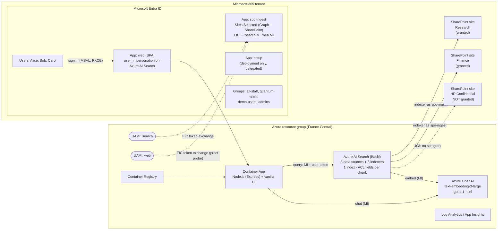
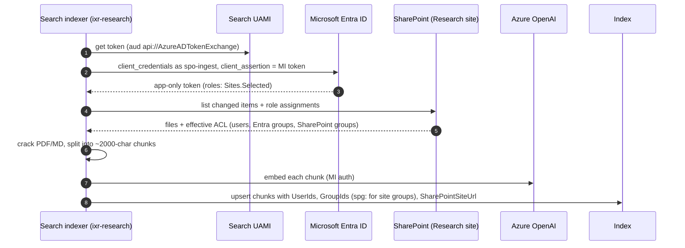
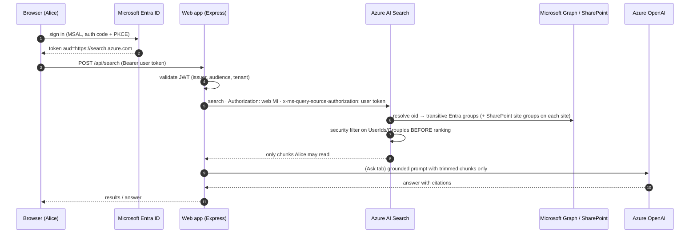

# Architecture

## Components

## Identities and permissions

| Identity | Type | Permissions | Used for |
|---|---|---|---|
| **spo-ingest** app | App registration, **no secret** | Graph `Sites.Selected` · SharePoint `Sites.Selected`, `User.Read.All` (application, admin-consented) + **per-site grant** on Research and Finance only | SharePoint indexer (content + ACLs), query-time SharePoint site group resolution |
| Search UAMI | User-assigned managed identity | Federated credential subject on spo-ingest · `Cognitive Services OpenAI User` | Indexer → SharePoint, embeddings, query vectorizer |
| Web UAMI | User-assigned managed identity | `Search Index Data Reader/Contributor`, `Search Service Contributor`, `Cognitive Services OpenAI User`, `AcrPull`, Graph `GroupMember.Read.All` + `User.ReadBasic.All` (application), FIC subject on spo-ingest | Query authorisation, chat, admin views, Sites.Selected probe |
| **web** app | SPA app registration | Delegated: `openid profile offline_access User.Read`, Azure AI Search `user_impersonation` (consented for all users), `GroupMember.ReadWrite.All` (consented for the deploying admin only) | End-user sign-in/out; the user token is what Azure AI Search uses to trim results |
| **setup** app | Public client | Delegated, consented for the deploying admin only: Graph `Sites.FullControl.All`, `Files.ReadWrite.All`, `User.ReadWrite.All`, `Group.ReadWrite.All`, `LicenseAssignment.ReadWrite.All`, `UserAuthenticationMethod.ReadWrite.All`, `Policy.ReadWrite.AuthenticationMethod`, `Organization.Read.All` · SharePoint `AllSites.FullControl` | Deployment-time only: create sites, folders, permissions, users, Sites.Selected grants. Safe to delete afterwards |
| Deploying admin | User | `Search Service Contributor`, `Search Index Data Contributor`, `Cognitive Services OpenAI User` | Creating the search pipeline, local development |

No API keys anywhere: Azure AI Search and Azure OpenAI have local (key) auth **disabled**.

## Ingestion flow

For the **HR** site step 4 fails with *access denied*: the app's token is valid and admin-consented, but SharePoint has no site permission for it.

## Query flow

Key properties:

* The app never filters results itself — trimming happens inside Azure AI Search.
* Without a user token, ACL-protected documents are **not** returned (behaviour since the 2025-11-01-preview API).
* Entra group membership is resolved at **query time**: adding Carol to *Quantum team* takes effect on the next query, no re-indexing.
* If ACL evaluation fails (for example Graph unavailable) the service returns 5xx — never a partially filtered result.

## Data model (index `sharepoint-acl-index`)

| Field | Purpose |
|---|---|
| `chunk_id` (key), `parent_id` | Chunk and source-document keys (index projections, `skipIndexingParentDocuments`) |
| `title`, `url`, `path`, `site`, `last_modified` | SharePoint metadata (`metadata_spo_*`) |
| `chunk`, `chunk_vector` (3072-d) | Text and embedding; integrated vectorizer for queries |
| `UserIds` (`permissionFilter: userIds`) | Entra object IDs of users granted directly |
| `GroupIds` (`permissionFilter: groupIds`) | Entra group object IDs, and SharePoint site groups as `spg:<id>` |
| `SharePointSiteUrl` (`sharepointSiteUrl: true`) | Lets the service resolve SharePoint site groups per site at query time |

Index-level settings: `permissionFilterOption: enabled` and `sharePointConnectorAppRegistration` (spo-ingest app ID + search UAMI client ID).

## Demo content and permissions

| Site / folder | SharePoint permission | Who sees it | Codeword |
|---|---|---|---|
| Research / Public | inherits site: **All staff** Entra group = Read | Alice, Bob, Carol | BLUEBIRD |
| Research / Quantum | unique: **Quantum team** Entra group = Read | Alice | AURORA |
| Research / Bio | unique: **Carol** (direct user) = Read | Carol | KESTREL |
| Finance / Reports | inherits site: SharePoint **Members** site group (contains Bob) | Bob | NIGHTJAR |
| HR / Confidential | inherits site: All staff = Read, **but no Sites.Selected grant** | nobody (never indexed) | OSPREY |

Every folder contains an *Access note* markdown file with its codeword plus CC BY 4.0 arXiv papers on the folder's topic.
