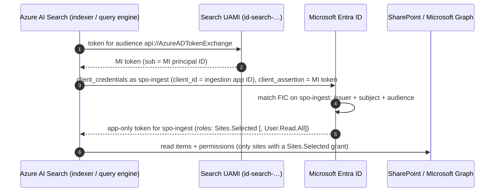

# Federated identity: setup, values and permissions

The SharePoint indexer signs in to SharePoint as an **app registration** (`spo-ingest`) but never uses a client secret
or certificate. Instead, the app has a **federated identity credential (FIC)** that trusts the search service's
**user-assigned managed identity** (UAMI). Azure AI Search gets a token for its managed identity and presents it as the
client assertion for `spo-ingest`; Microsoft Entra ID returns an app-only token with `roles: Sites.Selected`.

A federated credential is **required** as soon as SharePoint (not just Graph) permissions are involved — that is, for
SharePoint site group ACLs and their query-time resolution
([documentation](https://learn.microsoft.com/azure/search/search-indexer-sharepoint-access-control-lists)).



## The objects

| Object | Created by | Name in this repo |
|---|---|---|
| Search user-assigned managed identity | [`core.bicep`](../infra/modules/core.bicep) | `id-search-<token>`, attached to the search service |
| Ingestion app registration + service principal | [`entra.bicep`](../infra/modules/entra.bicep) | `<prefix> SharePoint ingestion (Sites.Selected)` |
| FIC `search-indexer-mi` on the ingestion app | `entra.bicep` | trusts the search UAMI (indexer + query-time SharePoint group resolution) |
| FIC `web-proof-mi` on the ingestion app | `entra.bicep` | trusts the **web** UAMI — only for the live Graph probe on the *Sites.Selected proof* tab. Not needed in production |
| Per-site `Sites.Selected` grant | [`sharepoint.mjs`](../scripts/setup/steps/sharepoint.mjs) | `read` on Research and Finance; none on HR |

## Federated credential values

| FIC field | Value | Notes |
|---|---|---|
| Scenario (portal) | *Managed identity* (or *Other issuer* with the values below) | |
| Issuer | `https://login.microsoftonline.com/<tenant-id>/v2.0` | Bicep: `${environment().authentication.loginEndpoint}${tenant().tenantId}/v2.0` |
| Subject identifier | Managed identity **object (principal) ID** | Not the client ID |
| Audience | `api://AzureADTokenExchange` | Default; don't change |
| Name | `search-indexer-mi` | Any unique name; not referenced anywhere else |

## Which ID goes where

This is the part that's easy to get wrong. Three different GUIDs identify the managed identity and the app:

| Value | Where to find it | Used in | azd env variable |
|---|---|---|---|
| Ingestion app **application (client) ID** | App registrations → app → Overview | Data source `ApplicationId=` · index `sharePointConnectorAppRegistration.applicationId` · `POST /sites/{id}/permissions` grant | `INGEST_APP_CLIENT_ID` |
| Search UAMI **client ID** | Managed identity → Overview / Properties | Data source `FederatedCredentialApplicationId=` · index `sharePointConnectorAppRegistration.federatedCredentialId` | `SEARCH_IDENTITY_CLIENT_ID` |
| Search UAMI **object (principal) ID** | Managed identity → Overview, or Enterprise applications | FIC **subject** only | (bicep output only) |
| Search UAMI **resource ID** | Managed identity → Properties | Data source `identity.userAssignedIdentity` · skillset / vectorizer `authIdentity` | `SEARCH_IDENTITY_RESOURCE_ID` |
| Tenant ID | Entra ID → Overview | Data source `TenantId=` · index `sharePointConnectorAppRegistration.tenantId` · FIC issuer | `AZURE_TENANT_ID` |
| FIC entry's own GUID | App → Certificates & secrets → Federated credentials | **Nowhere** — don't use it for `federatedCredentialId` | — |

With a **system-assigned** identity instead of a UAMI, use the identity's application ID from *Enterprise applications →
(search service name) → Properties* for `FederatedCredentialApplicationId` / `federatedCredentialId`, and omit the
`identity` property on the data source.

The resulting definitions ([`datasource.json`](../scripts/search/datasource.json), [`index.json`](../scripts/search/index.json)):

```jsonc
// data source
"credentials": {
  "connectionString": "SharePointOnlineEndpoint=<site URL>;ApplicationId=<ingestion app client ID>;FederatedCredentialApplicationId=<search UAMI client ID>;TenantId=<tenant ID>"
},
"identity": {
  "@odata.type": "#Microsoft.Azure.Search.DataUserAssignedIdentity",
  "userAssignedIdentity": "<search UAMI resource ID>"
}

// index
"sharePointConnectorAppRegistration": {
  "applicationId": "<ingestion app client ID>",
  "federatedCredentialId": "<search UAMI client ID>",
  "tenantId": "<tenant ID>"
}
```

## Required permissions

### Ingestion app (application permissions, admin consent)

| API | Permission | Why |
|---|---|---|
| Microsoft Graph | `Sites.Selected` | Read files and their Entra permissions (users, Entra groups) on granted sites |
| SharePoint | `Sites.Selected` | Read SharePoint **site group** permissions (Owners / Members / Visitors) — SharePoint REST only |
| SharePoint | `User.Read.All` | Query-time: resolve which SharePoint site groups the searching user belongs to |

`Sites.Selected` scopes the two `Sites.Selected` permissions only. SharePoint `User.Read.All` is tenant-wide: the app
can read SharePoint group names and members on every site (no content) — measured in the [API lab](api-lab.md). Leave
both SharePoint permissions out if you only use Entra users and groups.

Admin consent alone gives access to **no** site. Each site needs a grant, made by an admin with
`Sites.FullControl.All` (here: the setup script, delegated):

```http
POST https://graph.microsoft.com/v1.0/sites/{site-id}/permissions
{ "roles": ["read"], "grantedToIdentities": [{ "application": { "id": "<ingestion app client ID>", "displayName": "…" } }] }
```

`read` is enough (validated, see [sites-selected-proof.md](sites-selected-proof.md)). Graph `Files.Read.All`, listed in
the documentation, is tenant-wide and deliberately not granted ([limitations.md](limitations.md#filesreadall)).

### Azure RBAC

| Principal | Role | Scope | Why |
|---|---|---|---|
| Search UAMI | Cognitive Services OpenAI User | Azure OpenAI | Embedding skill and query-time vectorizer |
| Web UAMI | Search Index Data Reader | Search service | Run queries (the user's token trims results) |
| Web UAMI | Search Index Data Contributor, Search Service Contributor | Search service | Demo admin features (elevated read, run indexers). Not needed for a read-only app |
| Deploying admin | Search Service Contributor, Search Index Data Contributor | Search service | Create the pipeline |

The search UAMI needs **no** Azure role for SharePoint: its only power there is being trusted by the ingestion app's FIC.

### Query time

The calling app sends its own credential (`Authorization`, here the web UAMI) **and** the end user's Entra token
(`x-ms-query-source-authorization`, audience `https://search.azure.com`). Azure AI Search uses the user token to get the
user's object ID and groups, and — through `sharePointConnectorAppRegistration` and the same FIC — asks SharePoint which
site groups the user belongs to on each site in `SharePointSiteUrl`. The web app registration therefore needs the delegated
Azure AI Search `user_impersonation` scope.

## Doing it by hand (without azd)

1. **Managed identity:** create a user-assigned managed identity and attach it to the search service (*Settings →
   Identity → User assigned*). Note its client ID, object (principal) ID and resource ID.
2. **App registration:** single tenant, no redirect URI, **no secret**.
3. **API permissions:** add the three application permissions above → *Grant admin consent*.
4. **Federated credential:** app → *Certificates & secrets → Federated credentials → Add credential* → scenario
   *Managed identity* → select the UAMI (or *Other issuer* with the issuer / subject / audience values above).
5. **Site grant:** `POST /sites/{site-id}/permissions` (Graph Explorer or `Grant-PnPAzureADAppSitePermission`) for each site
   to index.
6. **RBAC:** search UAMI → *Cognitive Services OpenAI User* on Azure OpenAI.
7. **Search objects:** data source and index with the values from [Which ID goes where](#which-id-goes-where).

In this repo steps 1–4 and 6 are Bicep ([`core.bicep`](../infra/modules/core.bicep),
[`entra.bicep`](../infra/modules/entra.bicep)), step 5 is [`sharepoint.mjs`](../scripts/setup/steps/sharepoint.mjs), and
step 7 is [`search.mjs`](../scripts/setup/steps/search.mjs).

## Checking it

| Check | How | Expected |
|---|---|---|
| FIC exists | `GET https://graph.microsoft.com/v1.0/applications(appId='<ingestion app ID>')/federatedIdentityCredentials` | `search-indexer-mi` with subject = search UAMI principal ID |
| Consent | Entra → Enterprise applications → ingestion app → *Permissions* | Graph `Sites.Selected`, SharePoint `Sites.Selected` + `User.Read.All` |
| Site grants | `GET /sites/{host}:/sites/{path}:/permissions`, or the *Sites.Selected proof* tab as an admin | Research, Finance: the app with `read`; HR: none |
| End to end | Indexer status on the Admin tab | Research / Finance succeed; `ixr-hr` is rejected with *accessDenied* |

Common errors:

| Symptom | Cause |
|---|---|
| `AADSTS70021: No matching federated identity record found` | Subject is the client ID instead of the principal ID, or wrong issuer / audience |
| `AADSTS700016` / invalid client | `ApplicationId` is the UAMI's ID instead of the ingestion app's |
| Indexer creation fails with *accessDenied* | No `Sites.Selected` grant on that site (expected for HR) |
| Bob doesn't see NIGHTJAR (SharePoint group access) | Index lacks `sharePointConnectorAppRegistration`, or the app lacks SharePoint `User.Read.All` |
