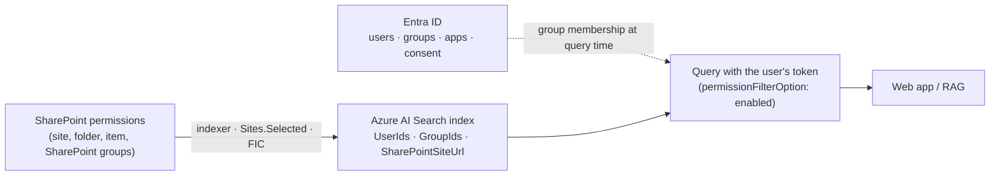

# Roles, platform guardrails and audit logs

Who can change what — in Azure, Microsoft Entra ID and SharePoint — so that a user ends up seeing documents through
search, which guardrails the platforms provide, and which audit log records each change. Complements
[index-integrity.md](index-integrity.md) (attacks on the index and their detection) and
[federated-identity.md](federated-identity.md) (the ingestion identity).

Entries marked **✅ observed** were checked in the demo tenant; the rest come from the cited documentation.

## Where access is decided



A user sees a chunk if the **stored** ACL matches the user's object ID, Entra groups (resolved at query time) or
SharePoint groups (resolved at query time). So access can change in four places: SharePoint permissions, Entra
membership, the index (values and settings) and the identities that move data between them.

## Who can change what

### Azure (resource and data plane)

| Role | Scope | Can change | Effect on who sees what | Logged in |
|---|---|---|---|---|
| **Owner** | subscription / RG / service | Everything below, plus role assignments | Can grant anyone any role, re-enable keys | Activity Log (✅ observed: role assignment write/delete, role definition write, caller shown) |
| **User Access Administrator** | any | Role assignments | Can give itself Search Index Data Contributor → A1 below | Activity Log |
| **Contributor** | any | Service settings (`disableLocalAuth`, network, identity), list/regenerate keys, delete the service | Re-enabling keys gives full data-plane access with no identity | Activity Log (✅ `searchServices/write`, caller shown) |
| **Search Service Contributor** | search service | Same as Contributor on the service + create/modify indexes, skillsets, data sources, indexers | `permissionFilterOption: disabled`, remap `UserIds`, drop ACL ingestion, run/reset indexers | Service settings: Activity Log. Index/pipeline changes: **only** Search resource logs (`Indexes.Update`, … — ✅ observed, **no caller identity**) |
| **Search Index Data Contributor** | service or one index | Upload/merge/delete documents; elevated read | Merge `UserIds: ["all"]` (✅ measured: Bob gained access); inject documents; read everything with elevated read | Search resource logs `Indexing.Index` (✅ observed, no identity) |
| **Search Index Data Reader** | service or one index | Query | Nothing while `permissionFilterOption` is enabled (queries without a user token: 0 results — ✅ measured) | `Query.Search` |
| Custom *Search ACL demo web app* | search service | Query, read index stats, read/run/resync indexers | None on stored ACLs; `indexers/write` could still edit indexer mappings (demo-only) | Activity Log (assignment), resource logs (operations) |
| **Cognitive Services OpenAI User** | Azure OpenAI | Call models | None (the app grounds only on trimmed chunks) | Azure OpenAI resource logs |
| **Reader** | any | Nothing | None | — |

### Microsoft Entra ID

| Role | Can change | Effect on who sees what | Logged in |
|---|---|---|---|
| **Global Administrator** | Everything, including elevating to *User Access Administrator* on all Azure subscriptions | Any of the above | Entra audit log; Activity Log for Azure changes |
| **Privileged Role Administrator** | Entra role assignments, admin consent for any permission | Can consent `Sites.FullControl.All` / `Files.Read.All` to an app | Entra audit (*Add app role assignment to service principal*, *Consent to application*) |
| **Application Administrator / Cloud Application Administrator** | App registrations, credentials, **federated credentials**, owners | Add a secret or FIC to the ingestion app → read every granted site as the app | Entra audit (*Update application* — ✅ observed, *Certificates and secrets management*) |
| **App owner** (of the ingestion app) | Same as above for that app | Same | Entra audit |
| **Groups Administrator / User Administrator / group owners** | Group membership | Adding a user to *Quantum team* grants AURORA **immediately** (resolved at query time — ✅ measured) | Entra audit (*Add member to group* — ✅ observed, actor shown) |
| **Authentication Policy Administrator / User Administrator** | Temporary Access Passes, MFA methods | Sign in as a persona | Entra audit (*Admin registered security info* — ✅ observed) |
| **Security Administrator** | Diagnostic settings for Entra logs, Conditional Access | Can turn off log export | Entra audit (*Update policy*, *Update conditional access policy* — ✅ observed) |

### SharePoint / Microsoft 365

| Role | Can change | Effect on who sees what | Logged in |
|---|---|---|---|
| **SharePoint Administrator / Global Administrator** | Any site, site collection admins, **`Sites.Selected` grants** (`POST /sites/{id}/permissions` with `Sites.FullControl.All`) | Grant the ingestion app a new site (✅ measured: HR 403 → 200); add site admins | Purview audit (`SiteCollectionAdminAdded`, record type `SharePointAppPermissionOperation`); Graph activity log (`POST …/permissions`) |
| **Site collection admin / site owner** | Site and folder permissions, SharePoint groups, sharing | Changes the source ACL → flows into the index on the next run (item changes) or after `resync` (parent-scope changes) | Purview audit (`AddedToGroup`, `RemovedFromGroup`, `PermissionLevelsInheritanceBroken`, `SharingInheritanceBroken`, sharing events) |
| **Site member (Edit)** | Share items they can edit (if sharing allows) | "Specific people" shares are honoured; organisation/anyone links aren't ([limitations](limitations.md)) | Purview audit (sharing events) |
| **Visitor (Read)** | Nothing | None | — |

## Guardrails provided by the platforms

### Microsoft Entra ID

| Guardrail | What it stops | In this demo |
|---|---|---|
| **`Sites.Selected` (resource-specific consent)** | Admin consent alone grants **no** site; each site needs an explicit grant | ✅ HR never granted; proven 403 |
| **Admin consent required** for application permissions | Apps can't grant themselves `Sites.FullControl.All` / `Files.Read.All` | ✅ |
| **Federated identity credentials** | No secret to leak; tokens only for the matching issuer + subject + audience | ✅ search MI (and web MI for the demo) |
| **Delegated permissions bounded by the user** | `Sites.Read.All` / `Files.Read.All` in the web app read only what the user can already read | ✅ Access tab, API lab |
| **Per-user consent** (`consentType: Principal`) | Privileged delegated scopes only for named users | ✅ `Sites.FullControl.All` only for the deploying admin (others get AADSTS65001) |
| **PIM** (P2) | No standing privileged roles; approval, MFA, time limit, audit | Recommended for Owner, Search Service Contributor, SharePoint/Application admins |
| **Conditional Access** | Device/MFA/location for users; **Conditional Access for workload identities** (Workload ID Premium) can restrict the ingestion app's sign-ins by location | Not configured (demo) |
| **Access reviews** (P2) | Stale group memberships and role assignments | Recommended for the groups used in ACLs |

### SharePoint / Microsoft 365

| Guardrail | What it stops |
|---|---|
| Site-scoped `Sites.Selected` grants with roles `read` / `write` / `manage` / `fullcontrol` | The indexer needs only `read` (✅ validated); a `read` grant can't read or change grants or role assignments (✅ 403) |
| Grants only by `Sites.FullControl.All` holders | Ordinary site owners can't grant apps; site owners can't see app grants either |
| Sharing settings (tenant and site) | Limits who can widen access at the source |
| Unique permissions / inheritance | Folder-level restrictions that the indexer ingests per item |

### Azure AI Search

| Guardrail | What it stops | In this demo |
|---|---|---|
| **Roles-only auth** (`disableLocalAuth: true`) | Anonymous key-based access; every request is an Entra identity with a role | ✅ |
| **Separate control/data plane roles** + **custom roles** with atomic permissions | Query-only identities can't write documents or change the index | ✅ web app custom role |
| **Index-scoped role assignments** | Access to one index instead of all | Single index here |
| **`permissionFilterOption: enabled`** | Queries without a user token return nothing (✅ 0 of 445) | ✅ |
| **Fail-closed user token** | With the filter disabled, queries carrying `x-ms-query-source-authorization` are rejected (✅ HTTP 400) instead of returning everything | ✅ app always sends the user token |
| **Elevated read needs the caller's own user token** + Index Data Contributor or `elevatedOperations/read` | Apps can't silently bypass trimming | ✅ admins group only |
| **Network**: IP rules, private endpoints, `publicNetworkAccess: disabled`, trusted services | Stolen tokens from outside the network | Public (demo) |
| **Customer-managed keys**, double encryption | Data-at-rest key control (not tampering) | Not used |

### Azure platform

| Guardrail | What it stops | In this demo |
|---|---|---|
| **Azure Policy** — built-ins for Azure AI Search: disable local auth (Audit/Deny or Modify), disable public network access (Audit/Deny or Modify), deploy diagnostic settings (DeployIfNotExists), CMK (Audit) | Re-enabling keys, public exposure, removing logging | The tenant already enforces governance policies (✅ `policies/audit`, `deployIfNotExists` actions in the Activity Log) |
| **Resource locks** (`CanNotDelete`, `ReadOnly`) | Deletion of the service; `ReadOnly` also blocks control-plane writes (settings, key operations) — not data-plane document or index changes | Not used (would block `azd down`) |
| **Microsoft Defender for Cloud** | Posture recommendations and alerts on control-plane anomalies | Active in the tenant (✅ Defender security operators seen in sign-in logs) |
| **Managed identities** | No credentials in code or config | ✅ all service-to-service calls |

## Audit logs available

| Log | Records | Identity of the actor | Default retention | License / setup | ✅ Observed in the demo tenant |
|---|---|---|---|---|---|
| **Azure Activity Log** (`AzureActivity`) | Control plane: role assignments and definitions, service settings (`searchServices/write`), keys (`listAdminKeys`), diagnostic settings, deployments, policy effects | **Yes** (`caller`) | 90 days (free); export to Log Analytics for longer, up to 12 years | Free; diagnostic setting to export | Custom role write, 8 role assignment writes, 3 deletes, diagnostic setting write, `searchServices/write` — all with caller `admin@…` |
| **Azure AI Search resource logs** (`AzureDiagnostics`, `OperationLogs`) | Data plane: `Indexing.Index` (document writes, incl. the indexer's), `Indexes.Update`, `Indexers.*`, `DataSources.*`, `Skillsets.*`, `Query.Search` | **No** — operation, index, document count, status, **IP** | Workspace retention | Diagnostic setting (added in this repo) | Merges, `Indexes.Update` (filter disabled/enabled), runs, resyncs, queries — see [index-integrity.md](index-integrity.md#logging-what-was-measured) |
| **Entra audit log** (`AuditLogs`) | Users, groups (membership), apps (credentials, FIC, owners), service principals, consent and app role assignments, authentication methods (TAP), policies, CA | **Yes** (`initiatedBy`) | 7 days (Free), 30 days (P1/P2); export for longer | Free; Reports Reader to read | *Add/Remove member to group* (Bob ↔ Demo admins), *Update application* (ingestion app), *Add/Remove delegated permission grant*, *Admin registered security info* (TAP), *Delete/Hard delete application* |
| **Entra sign-in logs** — user, service principal, managed identity | Every token issued: who/which app, resource, IP, result, CA | **Yes** | 7 days (Free), 30 days (P1/P2) | Built in; export via diagnostic settings | Ingestion app → Microsoft Graph (32) and SharePoint (10); search and web MIs → *AAD Token Exchange Endpoint* (the FIC exchange); users → *Azure Cognitive Search* |
| **Microsoft Graph activity logs** (`MicrosoftGraphActivityLogs`) | Every Graph request: app ID, user/SP, method, URI, status, IP — e.g. `POST /sites/{id}/permissions` (grant), group changes | **Yes** | Only what's exported | Entra ID P1/P2 + diagnostic setting (Security Administrator) | Not enabled in the demo |
| **Microsoft Purview Audit** (unified audit log) | SharePoint: file access, sharing, `AddedToGroup` / `RemovedFromGroup`, inheritance changes, site collection admins, app permission operations (`SharePointAppPermissionOperation`); also Entra events | **Yes** (`app@sharepoint` for app-only actions) | 180 days (Standard); 1 year for SharePoint/Entra/Exchange with Audit (Premium, E5); up to 10 years with add-on | On by default; reading needs a Purview audit role | Not queried: admin@ has no Purview audit role in this tenant (HTTP 403) |
| **Azure OpenAI / Container Apps logs** | Model calls; app console logs | Partly (app logs whatever it writes) | Workspace retention | Diagnostic setting / built in | Container Apps logs flow to the same workspace |

### Which log answers which question

| Question | Look in |
|---|---|
| Who gave X a role on the search service? | Activity Log `Microsoft.Authorization/roleAssignments/write` |
| Who re-enabled keys or opened the network? | Activity Log `Microsoft.Search/searchServices/write` (+ `listAdminKeys/action`) |
| When was the permission filter disabled / a mapping changed? | Search resource logs `Indexes.Update`, `Skillsets.*`, `Indexers.Update` — then attribute via the time window: Entra sign-in logs list who obtained a token for *Azure Cognitive Search* then (✅ observed `admin@…` via *Microsoft Azure CLI*), cross-checked against holders of write roles. IPs differed between the two logs in our test (rotating egress) |
| Were ACL values in the index altered? | `verify-acls.mjs` (compares with SharePoint); Search logs `Indexing.Index` from non-Azure IPs |
| Who added Carol to *Quantum team*? | Entra audit *Add member to group* |
| Who added a credential / FIC to the ingestion app? | Entra audit *Update application* (modified property `FederatedIdentityCredentials` / `KeyCredentials`) |
| Who granted the ingestion app a new site? | Graph activity logs `POST /sites/{id}/permissions`; Purview `SharePointAppPermissionOperation` |
| Who changed folder permissions in SharePoint? | Purview audit site permission events |
| What did the ingestion app read? | Entra service principal sign-ins (when), Purview `FileAccessed` by the app (what) |
| Who searched for what? | Search `Query.Search` (query text, no identity) + the app's own logs (the app knows the user) |

### Sample queries

```kusto
// Control plane on the search service, with the caller
AzureActivity
| where ResourceProviderValue == "MICROSOFT.SEARCH" or OperationNameValue has "roleAssignments"
| project TimeGenerated, OperationNameValue, ActivityStatusValue, Caller, _ResourceId

// Index / pipeline changes (data plane, no identity)
AzureDiagnostics
| where ResourceProvider == "MICROSOFT.SEARCH" and OperationName in ("Indexes.Update", "Indexers.Update", "Indexers.Create")
| project TimeGenerated, OperationName, Description_s, CallerIPAddress

// Who could have made them: user tokens for Azure AI Search in the same window
SigninLogs
| where ResourceDisplayName == "Azure Cognitive Search"
| project TimeGenerated, UserPrincipalName, AppDisplayName, IPAddress

// Group membership and app credential changes
AuditLogs
| where OperationName in ("Add member to group", "Remove member from group", "Update application", "Add app role assignment to service principal")
| project TimeGenerated, OperationName, InitiatedBy, TargetResources
```

`AzureActivity`, `SigninLogs` and `AuditLogs` require exporting the Activity Log and the Entra logs (diagnostic
settings) to the same workspace; this demo exports only the search resource logs and Container Apps logs.

## Recommended baseline

1. **Export everything to one workspace** (or Microsoft Sentinel): Activity Log, Entra audit + sign-in logs (incl.
   service principal and managed identity), Graph activity logs, Search resource logs; Purview audit through the
   Office 365 Management Activity API. Set retention to your investigation window (≥ 1 year is common).
2. **Few, eligible writers**: PIM for Owner / Contributor / Search Service Contributor / SharePoint and Application
   administrators; no standing Search Index Data Contributor when only an indexer writes.
3. **Policy**: deny local auth and public network access on Azure AI Search; deploy diagnostic settings automatically.
4. **Alerts**: role assignments on the search service, `searchServices/write`, `Indexes.Update`, `Update application`
   on the ingestion app, `POST /sites/*/permissions`, group membership changes on groups used in ACLs.
5. **Integrity check on a schedule**: `verify-acls.mjs` — the only control here that detects altered ACL *values*.

## Sources

* [Azure activity log](https://learn.microsoft.com/azure/azure-monitor/fundamentals/activity-log) — 90-day retention, caller
* [Connect to Azure AI Search using roles](https://learn.microsoft.com/azure/search/search-security-rbac) and
  [Azure permissions for Microsoft.Search](https://learn.microsoft.com/azure/role-based-access-control/permissions/ai-machine-learning#microsoftsearch)
* [Azure AI Search monitoring data reference](https://learn.microsoft.com/azure/search/monitor-azure-cognitive-search-data-reference)
  and [Azure Policy built-ins for Azure AI Search](https://learn.microsoft.com/azure/search/policy-reference)
* [Microsoft Entra data retention](https://learn.microsoft.com/entra/identity/monitoring-health/reference-reports-data-retention)
  and [View activity logs of application permissions](https://learn.microsoft.com/entra/identity/enterprise-apps/app-perms-audit-logs)
* [Microsoft Graph activity logs](https://learn.microsoft.com/graph/microsoft-graph-activity-logs-overview)
* [Purview audit solutions](https://learn.microsoft.com/purview/audit-solutions-overview),
  [audit log activities](https://learn.microsoft.com/purview/audit-log-activities#site-permissions-activities) and
  [SharePointAppPermissionOperation record](https://learn.microsoft.com/graph/api/resources/security-sharepointapppermissionoperationauditrecord)
* [Resource-specific consent for SharePoint (`Sites.Selected`)](https://learn.microsoft.com/sharepoint/dev/sp-add-ins-modernize/understanding-rsc-for-msgraph-and-sharepoint-online)
